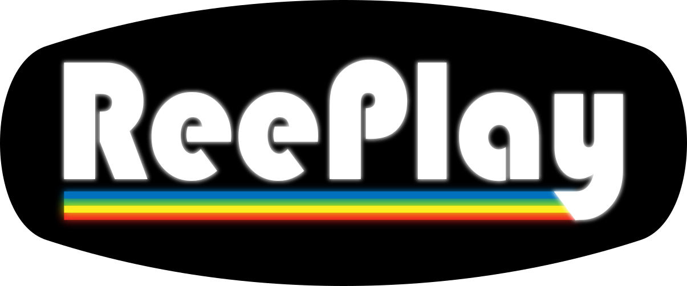
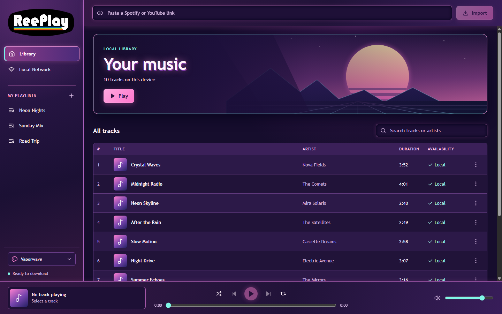
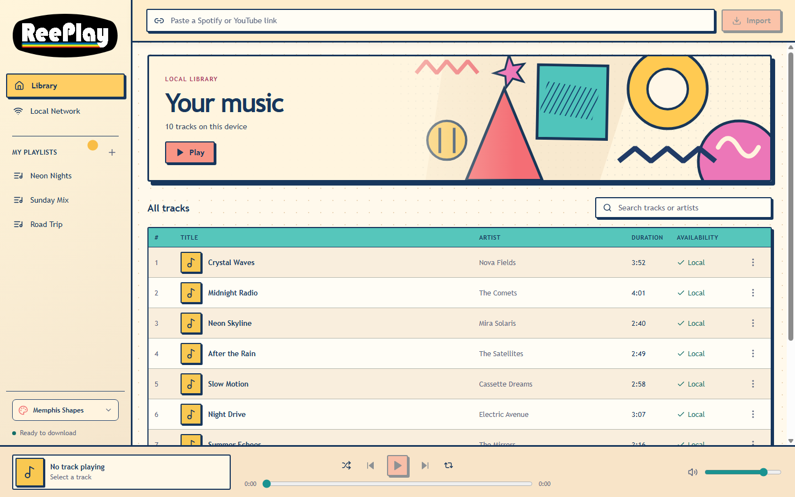

# ReePlay



**Desktop music player for Windows and Linux.** Organize local tracks, import public playlists, listen offline, and share your library with other computers on the same network. The interface is built with React and TypeScript inside a Tauri window; the local engine uses Python. No ReePlay account or database is required.



> This repository contains the **source code**. Local installer copies are stored in `INSTALLER/Windows` and `INSTALLER/Linux`. The binaries are excluded from Git because they exceed the file size limit; publish them as assets of a [GitHub Release](https://github.com/SimoGonzy/ReePlay/releases). Theme previews use sample data.

## Features

- **Import:** Paste a link to a public Spotify track, album, or playlist, or a YouTube video or playlist. ReePlay reads the track list, searches for matches on YouTube, and shows how many it found **before** downloading. Public Spotify pages are read without an account; this method may break if Spotify changes its website.
- **Download and playback:** yt-dlp and FFmpeg create MP3 files with title, artist, album, and cover art when available. Downloads continue in the background while you use the app. Saved files play offline.
- **Playlists:** Create playlists, change their names and covers, and move or copy tracks between playlists. You can delete a playlist while **keeping its tracks** in the Library, or delete its folder and files too.
- **ZIP sharing:** The **Share ZIP** button creates an archive containing MP3 files, `.info` metadata, and the cover. It uses ZIP_STORED, so MP3 files are neither re-encoded nor altered. The app shows the path of the archive in `content/share`.
- **Receiving a ZIP:** On another PC, extract the archive's folder into `content/library` to make the playlist appear in ReePlay. The [playlist sharing guide](docs/condivisione-playlist.md) explains the steps and what happens when you delete a playlist.
- **Local network:** Another PC running ReePlay can stream your library after pairing with a code and verifying the certificate fingerprint. Sharing must be enabled at each launch.
- **Appearance:** **Dark** is the default theme. The palette icon in the sidebar opens the theme list: Graphite 90, Vaporwave, Memphis Shapes, Stereo 2000, Coastal Sunset, and the custom JSON themes described in [Themes and plugins](docs/themes.md). On Windows, the title bar also follows the selected theme and includes the window controls.

ReePlay is independent of Spotify, YouTube, and yt-dlp. A Spotify link identifies tracks; the audio is found on YouTube and may be a different version. Download only content you have the right to download and keep.

## Installation

| System                        | Package                                                         | Launch                                                                                                                                                                                                            |
| ----------------------------- | --------------------------------------------------------------- | ----------------------------------------------------------------------------------------------------------------------------------------------------------------------------------------------------------------- |
| Windows x64                   | NSIS `.exe` installer from `INSTALLER/Windows` or a Release | Install and launch **ReePlay** from the Start menu.                                                                                                                                                         |
| Debian/Ubuntu x64             | `.deb` from `INSTALLER/Linux` or a Release                  | Run `sudo apt install ./ReePlay_*.deb`, then use the application menu or `reeplay`. If APT returns `404`, run `sudo apt update` and try again.                                                            |
| Other Linux x64 distributions | `.AppImage` from `INSTALLER/Linux` or a Release             | Run `chmod +x ReePlay_*.AppImage`, then launch the file. To add a command and menu icon, keep the AppImage, `ReePlay.png`, and `install-appimage.sh` in the same folder and run `sh install-appimage.sh`. |

Packages built with this repository's scripts include **Python, yt-dlp, Node.js, FFmpeg, FFprobe**, and the libraries needed for local network sharing. End users do not need to install these separately. The `.deb` installs the system graphics libraries required by Tauri; the AppImage may require FUSE. An Internet connection is needed to search for and download new tracks.

On Windows, enabling **Local Network** for the first time may trigger a Firewall prompt. Allow access **only on private networks**. The current installer works without administrator privileges and does not create an inbound rule; see [Firewall and networks](docs/rete-locale.md#firewall-and-networks).

## Quick start

1. Paste a link in the top bar and click **Import**.
2. Review the preview and click **Download**. The **Imports** panel shows results, progress, and errors while you continue using the app.
3. Open **Library** or a playlist. Search is available within the open collection. The player supports skipping, seeking, volume, repeat, and shuffle.
4. Use **+** to create an empty playlist and **Edit** to change its name and cover. A track's row menu lets you move or copy it, including into a new playlist.
5. In a playlist, click **Share ZIP** to create an archive to transfer as you wish. Use **Delete** to choose whether to keep its tracks.
6. To listen from another PC, follow the [local network guide](docs/rete-locale.md#connecting-two-pcs).

## Files and migration

Installations still use `~/Documents/MusicApp` as the **legacy data root**, even though the app is called ReePlay. On Windows, this is `Documents\MusicApp` in the user's profile. Keep this name to retain data from older versions. Set `MUSICAPP_DATA_DIR` before launch to choose a different root.

```text
Documents/MusicApp/
├─ content/
│  ├─ library/
│  │  ├─ Playlist name/
│  │  │  ├─ .info                  # JSON metadata
│  │  │  ├─ cover.png              # optional; JPEG and WebP also supported
│  │  │  └─ 01 - Artist - Title.mp3
│  │  └─ Single track.mp3
│  └─ share/
│     └─ Playlist name.zip
├─ config/network/                 # LAN identity and pairings
└─ themes/plugins/                 # custom JSON themes
```

At startup, ReePlay moves playlists and MP3 files from the old `content/` location into `content/library/`. It does not overwrite existing files: on a collision, it adds a number. Unrecognized files stay in place, and a second launch does not duplicate data. **Back up your library** before a significant upgrade.

`.info` is JSON with `titolo`, `numero_canzoni`, `lunghezza_minuti`, and `link_spotify` fields. Changing the displayed name does not rename the folder. A ZIP captures the files as they exist at export time. Personal data, ZIP archives, and `config/network/` are excluded from Git.

## Themes and previews

Graphite 90 evokes a 1990s tech music player with a graphite frame, turquoise display, and amber indicators. Vaporwave and Memphis Shapes use original illustrations. Coastal Sunset uses no official game assets. The following previews use fictional tracks.

| Vaporwave                                             | Memphis Shapes                                           |
| ----------------------------------------------------- | -------------------------------------------------------- |
|  |  |

See [Themes and plugins](docs/themes.md) to create or install a JSON theme.

## Local network and security

The window uses an HTTP API bound to `127.0.0.1`. Optional sharing starts a separate **HTTPS** service on the LAN. It exposes the catalog, covers, and audio as read-only resources, requires a per-PC credential, and supports revocation. Initial pairing requires certificate fingerprint verification. The loopback API checks the client address, `Host`, and `Origin`; file paths are confined to the library.

The [local network guide](docs/rete-locale.md) explains pairing, firewall behavior, and limitations. In the local development copy, security tests cover pairing codes, rate limiting, authorization, revocation, symbolic links, and untrusted web origins. The `tests/` folder is excluded from the public repository at the project's request.

## Building from source

**Prerequisites:** Python 3.10+, Node.js 22+, npm, Rust, and the system-specific [Tauri prerequisites](https://v2.tauri.app/start/prerequisites/). To test downloads during development, FFmpeg and FFprobe must be on `PATH`.

```text
musicapp/                    API, files, imports, and LAN
frontend/src/               React, TypeScript, themes, and player
frontend/src-tauri/         Desktop window and installers
frontend/public/images/     Theme illustrations
packaging/                   Linux packaging
scripts/                     Setup and build
themes/examples/             Example JSON themes
tests/                       Python tests in the local development copy
docs/                        Guides and previews
backend_entry.py             Packaged Python engine entry point
```

On Windows, run `scripts\setup-windows.bat` and `scripts\build-windows.bat`. On Linux, run `sh scripts/setup-linux.sh` and `sh scripts/build-linux.sh`. On Windows with Docker Desktop for Linux, run `powershell -ExecutionPolicy Bypass -File scripts/build-linux-docker.ps1`. Installers are produced in `frontend/src-tauri/target/release/bundle/` or, with Docker, `dist-linux/`. Builds download external tools with verified SHA-256 hashes; see [provenance and licenses](docs/third-party-binaries.md).

To check the frontend after cloning:

```bash
cd frontend
npm ci
npm run build
```

The local development copy also contains Python tests: `python -m unittest discover -s tests -v`. The `tests/` folder is ignored by Git and is not distributed with the repository.

After a Windows build, `powershell -ExecutionPolicy Bypass -File scripts/smoke-windows.ps1` launches the packaged sidecar with temporary data and checks FFmpeg, folders, ZIP export, and deletion. On Linux, `packaging/linux/smoke-test.sh` performs a similar check on the `.deb` and verifies that local network sharing starts.

To run the desktop in development, complete setup and install `requirements-build.txt` in the Python environment, then run `npm run sidecar:build` and `npm run desktop:dev` in `frontend/`. On Linux, add `-- --config src-tauri/tauri.linux.conf.json`. See the [desktop architecture](docs/desktop.md) and [contribution guide](CONTRIBUTING.md).

## Limitations and common issues

- **Spotify:** Only public pages work. ReePlay reads data exposed by the website, so service changes may break this method.
- **Matches:** YouTube search may select a live version, remix, or similar video. A found result may later fail to download because of removal or restrictions.
- **Quality:** yt-dlp selects `bestaudio/best`, and MP3 conversion uses VBR quality `0`, FFmpeg's highest setting. This cannot restore detail missing from the source. It may increase file size and conversion time; existing MP3 files do not change. ZIP preserves the bytes of already downloaded files.
- **JavaScript runtime:** If yt-dlp reports that Node is missing, check `bundled-tools/node` (`node.exe` on Windows) in the package. During development, run `node --version` in the same terminal. ReePlay enables Node for yt-dlp.
- **Covers:** If a remote image is unavailable, the audio file remains playable.
- **LAN:** The router may block mDNS discovery; enter the IP address and port manually. Sharing does not expose the library to the Internet or synchronize files.

## Licenses

The code is available under the [MIT license](LICENSE). Third-party components retain their own licenses; see [third-party binaries](docs/third-party-binaries.md). The [ReePlay logo](docs/brand/README.md) appears in the app, system icon, and installers.

## AI

AI has been used for this project, especially for documentation and graphics.
