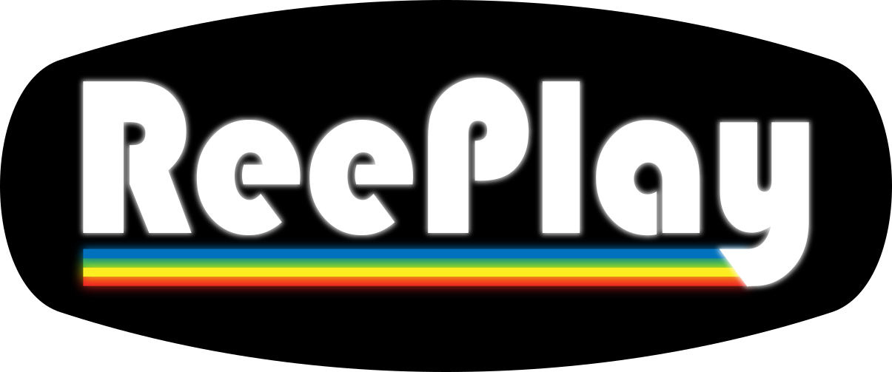
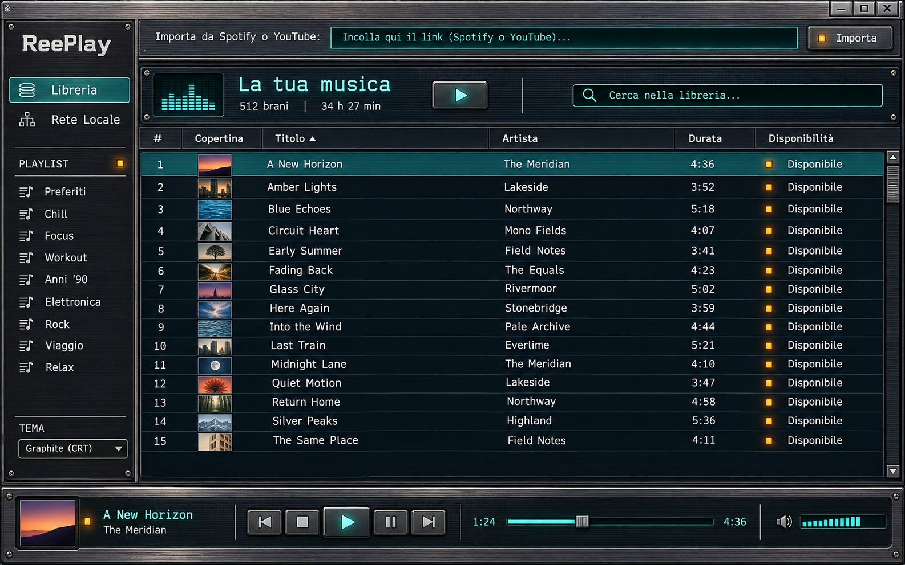

# ReePlay logo

The supplied brand artwork is a white **ReePlay** wordmark on black, with four blue, green, yellow, and red lines. The app uses a clean vector version in the interface. The square icon uses the original **R** and the same four lines so it remains readable in the Windows taskbar and Linux application menu.

The full wordmark is `frontend/public/images/reeplay-wordmark.svg`, and `frontend/app-icon.svg` is the icon source. Icons in `frontend/src-tauri/icons` are generated from the latter. To regenerate them, run `cd frontend` and `npx tauri icon app-icon.svg`.

The default theme is **Scuro** (Dark). Optional **Graphite 90** evokes 1990s audio players and tech software: graphite chassis, turquoise display, amber indicators, and raised buttons.

The concept is a visual reference for the main screen. The actual interface uses existing React components, the theme in `frontend/src/retro.css`, and the vector equalizer in `frontend/public/images/retro-equalizer.svg`. Other theme images remain available. [Earlier concepts](concepts.svg) are kept as an archive and are not ReePlay logos.

A preliminary search on 26 November 2026 found an [entertainment platform named Reeplay](https://www.reeplay.app) and a [UK trademark application for Reeplay in software](https://www.ipo.gov.uk/t-tmj.htm/t-tmj/t-tmj/tm-journals/2025-036/jnl.pdf). Before publishing ReePlay as a brand, check name availability in the territories and categories relevant to you. This preliminary search is not a formal trademark clearance.

The `Documents/MusicApp` data folder and some internal identifiers remain unchanged so the renamed app can read existing tracks, themes, and network pairings.
