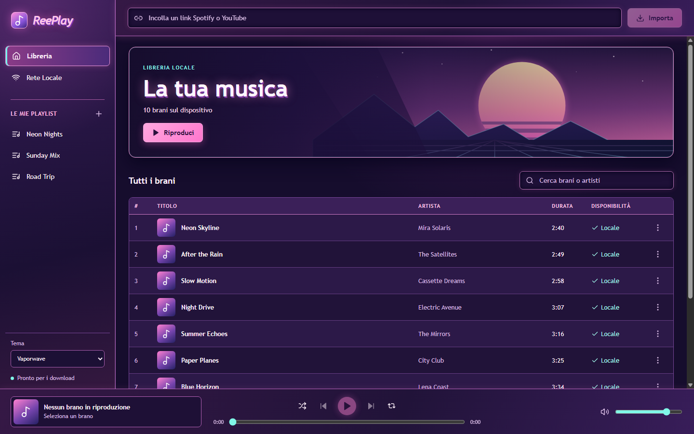
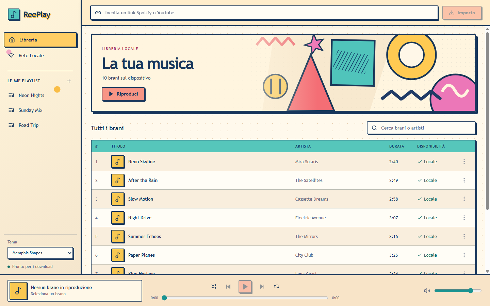

# ReePlay themes and plugins

ReePlay starts with the **Scuro** (Dark) theme. Click the **palette** icon at the bottom of the sidebar to open the list and choose **Graphite 90**, **Vaporwave**, **Memphis Shapes**, **Stereo 2000**, **Tramonto costiero**, or a theme you installed. The selection is saved in the desktop window's `localStorage`. If the old Chiaro theme or the previous default Graphite 90 was selected, this version switches to Scuro on first launch. You can then select Graphite 90 again from the palette.

**Vaporwave** uses dark purple, neon pink, and cyan, with a sunset horizon and perspective grid. **Memphis Shapes** uses a cream background, colorful geometric forms, and crisp borders. The original illustrations are SVG files in `frontend/public/images/vaporwave-horizon.svg` and `frontend/public/images/memphis-shapes.svg`; shared components are styled in `frontend/src/visual-themes.css`. Custom playlist covers remain visible in both themes.

The previews below use fictional tracks and show the Library at 1440×900.





**Tramonto costiero** evokes the atmosphere of GTA VI with a purple, coral, and pink palette and an original coastal panorama created for ReePlay. It contains no official game logos, characters, or images. The illustration is in `frontend/public/images/coastal-sunset.png` and appears only when that theme is selected.

**Stereo 2000** uses translucent panels, glossy buttons, and an original sky-and-hills landscape in `frontend/public/images/aero-landscape.png`. It does not reproduce an existing operating system background. Theme images and SVGs are frontend source assets; Vite copies them into `frontend/dist/images/` during the build.

## Installing a theme

1. Copy a `.json` file into `~/Documents/MusicApp/themes/plugins/` for the installed desktop app, or into `themes/plugins/` in the source project.
2. Restart ReePlay, then choose the theme from the **Tema** (Theme) menu.

A ready-to-edit example is available in `themes/examples/ambra.json`. Copy it into the app's plugin folder and modify it. You can add example manifests to the repository to share them.

## Manifest format

```json
{
  "id": "my_theme",
  "name": "My theme",
  "style": "flat",
  "colors": {
    "bg": "#111827",
    "text": "#ffffff",
    "accent": "#50a7ff"
  }
}
```

`id` accepts lowercase letters, digits, `_`, and `-` (2–32 characters, starting with a letter). `name` is the label shown in the app (maximum 40 characters). `style` can be `flat` or `glossy`; glossy adds highlights and raised borders modeled on Stereo 2000. Colors are hexadecimal `#RRGGBB` strings. Available keys are `bg`, `sidebar`, `surface`, `text`, `muted`, `border`, `accent`, `accent_text`, `selected`, `row_alt`, `player`, `danger`, and `positive`. Missing keys inherit the dark theme. Invalid manifests are ignored.

Themes are **data only**: they do not run JavaScript or Python. To propose a theme on GitHub, add a manifest in `themes/examples/` and a screenshot demonstrating readable text, selection states, and controls.
